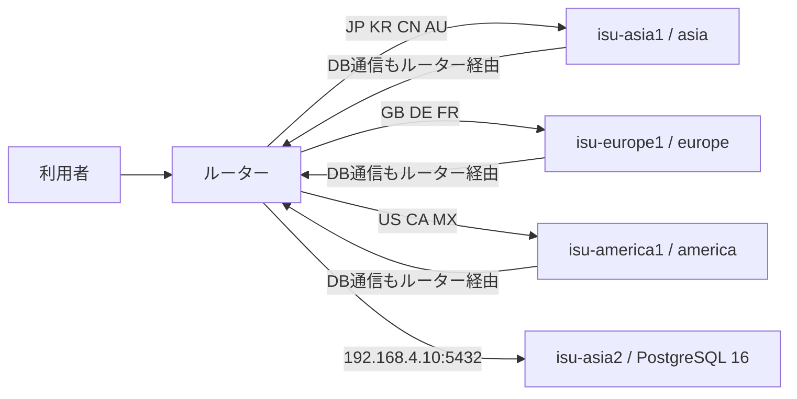

# ISUCON2026

ISUCON2026 のアプリケーションと運用スクリプトを管理するリポジトリ。競技環境は3台のリージョン別アプリケーションサーバーと、1台の共有データベースサーバーで構成される。

## サーバー構成

次の表は、2026-10-31 に実機で確認した役割とネットワーク設定を示す。アプリケーションサーバー3台では nginx が 80 番で待ち受け、`/api/` を同じホストの Go アプリケーション（8080 番）へ転送する。その他のパスは `/home/isucon/webapp/public` から配信する。

| ホスト | IP | 固定リージョン | 実機で確認した役割 |
|---|---|---|---|
| `isu-asia1` | `192.168.1.10` | `asia` | nginx と Go アプリケーション |
| `isu-europe1` | `192.168.2.10` | `europe` | nginx と Go アプリケーション |
| `isu-america1` | `192.168.3.10` | `america` | nginx と Go アプリケーション |
| `isu-asia2` | `192.168.4.10` | `asia` | PostgreSQL 16（5432 番）のみ |

3台のアプリケーションサーバーは、すべて `192.168.4.10:5432` の PostgreSQL に接続する。`isu-asia2` はアプリケーションの配置先ではないため、Go アプリのデプロイ対象に含めない。



ルーターは `X-Country-Code` に応じて転送先を選ぶ。省略時は `JP` として `isu-asia1` に転送する。アプリケーションサーバーから DB への通信を含むサーバー間通信もルーターを経由し、直接接続で迂回しない。リージョン間には遅延と帯域制限があり、`isu-asia1` と `isu-asia2` は同じ `asia` リージョンに属する。

初期構成では4台すべてを利用する。ベンチマークはリージョンごとにアプリへ振り分けるため、単一のアプリケーションサーバーだけを対象にする構成ではない。

## デプロイと設定反映

Go アプリケーションの変更は、次のコマンドで3台のアプリケーションサーバーへ反映する。ホストを指定した場合はそのホストだけが対象になる。

```sh
./ops/deploy.sh
./ops/deploy.sh isu-europe1
```

このスクリプトはソースを一時領域へ転送してサーバー上でビルドし、実行ファイルを入れ替えて `isureal-go` を再起動する。`isu-asia2` の DB 設定や SQL、静的ファイルは対象外。

nginx 設定はアプリ3台、PostgreSQL 設定は共有 DB のみへ反映する。nginx は構文検査後に reload し、PostgreSQL は設定を検査して reload する。PostgreSQL の再起動が必要な設定変更はスクリプトが拒否する。

```sh
./ops/deploy-config.sh nginx
./ops/deploy-config.sh postgresql
```

SQL スキーマ・インデックスと `webapp/public` の静的ファイルは、これらのデプロイスクリプトでは配布しない。変更時は別途反映する。OS 再起動用の `./ops/reboot.sh` は全4台が既定の対象で、再起動要求を約1分後に予約する。

設定ファイル一覧、反映手順、nginx の LTSV ログと alp 分析については [`ops/config/README.md`](ops/config/README.md) を参照。競技規約やネットワーク制約の詳細は、運営配布の競技マニュアルを参照する。

