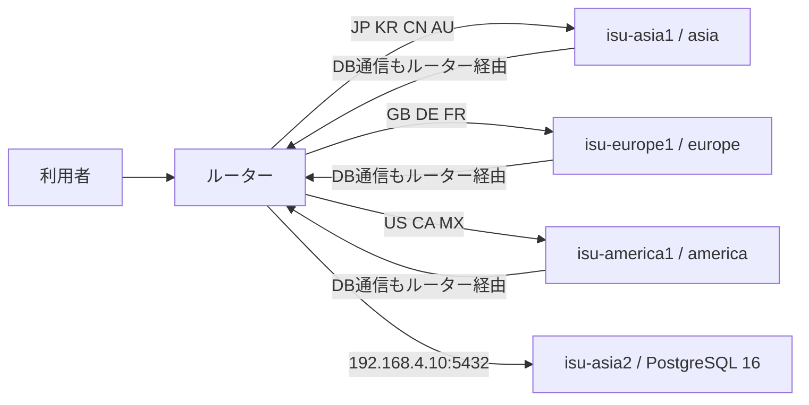

# ISUCON2026

ISUCON2026 のアプリケーションと運用スクリプトを管理するリポジトリ。競技環境は3台のリージョン別アプリケーションサーバーと、1台の共有データベースサーバーで構成される。

## サーバー構成

次の表は、2026-10-31 に実機で確認した役割とネットワーク設定を示す。アプリケーションサーバー3台では nginx が 80 番で待ち受け、`/api/` を同じホストの Go アプリケーション（8080 番）へ転送する。その他のパスは `/home/isucon/webapp/public` から配信する。

| ホスト | IP | 固定リージョン | 実機で確認した役割 |
|---|---|---|---|
| `isu-asia1` | `192.168.1.10` | `asia` | nginx と Go アプリケーション |
| `isu-europe1` | `192.168.2.10` | `europe` | nginx と Go アプリケーション |
| `isu-america1` | `192.168.3.10` | `america` | nginx と Go アプリケーション |
| `isu-asia2` | `192.168.4.10` | `asia` | PostgreSQL 16（5432 番）のみ |

3台のアプリケーションサーバーは、すべて `192.168.4.10:5432` の PostgreSQL に接続する。`isu-asia2` はアプリケーションの配置先ではないため、Go アプリのデプロイ対象に含めない。



ルーターは `X-Country-Code` に応じて転送先を選ぶ。省略時は `JP` として `isu-asia1` に転送する。アプリケーションサーバーから DB への通信を含むサーバー間通信もルーターを経由し、直接接続で迂回しない。リージョン間には遅延と帯域制限があり、`isu-asia1` と `isu-asia2` は同じ `asia` リージョンに属する。

Clar #55 により、他インスタンスとの通信を目的としてルーターのIPアドレス宛に443番または8080番ポートへ接続することは禁止されている。これはリージョン、通信遅延、帯域制限を変更または回避する行為にあたる。宛先IPの別名化やプロキシなどで同じ経路を作ることも認められない。別サーバー自身のIP・サービスへ通常のサーバー間通信としてルーター経由で接続することは、この禁止事項とは区別する。

新しくインスタンスを作成する場合は、他インスタンスからルーターの443番・8080番ポートへアクセスできないよう更新されたCloudFormationテンプレートを使う。運営告知では既存インスタンスの作り直しは不要とされている。ただし、複数スタックを作成している場合、運営による既存ルーター更新完了後もアプリケーションから `192.168.10.10:8080` にアクセスできるならスタックを再作成する。最終計測時にこの宛先へアクセス可能な場合は失格となる。運営のルーター／ベンチマーカー更新中にベンチマークが失敗した場合は、更新完了後に再実行する。更新時刻は別途の運営告知を確認する。

到達可否の確認では運営の更新完了情報と設定を確認し、到達不能を確認できていない場合は未確認として扱う。

初期構成では4台すべてを利用する。ベンチマークはリージョンごとにアプリへ振り分けるため、単一のアプリケーションサーバーだけを対象にする構成ではない。

## デプロイと設定反映

Go アプリケーションと共通アプリ設定の変更は、次のコマンドで3台すべてへ一括反映する。ホスト単位の配備には対応しない。

```sh
./ops/deploy.sh --dry-run
./ops/deploy.sh
```

このスクリプトはソースを一時領域へ転送して各サーバー上でビルドし、実行ファイルを入れ替えて `isureal-go` を再起動する。ホスト固有の完全な環境設定はローカルの `ops/env/<host>/env.sh` から配布し、追跡対象の共通設定からidle値と地域別open上限を読み取って `ISUREAL_DB_MAX_IDLE_CONNS` と `ISUREAL_DB_MAX_OPEN_CONNS` を末尾に生成する。配布元はこのローカルファイルなので、サーバー上だけで行った設定変更は配備時に置き換わる。systemdの`EnvironmentFile`はシェルとして実行されないため、`source` 行ではなく`KEY=VALUE`を直接記述する。

各ホストの環境ファイルはDB認証情報等の秘密を含む。これらはローカル作業ツリーに置き、mode 0600で保護する。Gitでは追跡しないため、新しいcheckoutには含まれず、別途承認済みの安全な方法で復元する必要がある。deployは3ファイルすべての存在・権限・Bash構文をSSH前に検査し、構文検査の詳細出力は抑制する。共通設定は内容を評価せず、idle 0〜30、各地域open 1〜90、idle以上、かつ地域合計90以下を検証する。dry-runも同じ検査を行い、設定内容を表示しない。

共通アプリ設定は追跡対象の [`ops/config/app.env`](ops/config/app.env) で管理する。idle値と地域別open上限はこの1ファイルで変更する。idle16は単発走行で暫定採用し、再現性とDBメモリ影響は未確認。open上限のAsia40 / Europe25 / America25（合計90）は未ベンチマーク・未配備の比較候補で、実測済みのidle16 / open30（スコア11450）とは区別する。追加で取得するアプリログは `db_pool_config` と `db_pool_stats` のみ。各ホストの `isureal-go` journalからベンチ実行時間帯を保存し、起動時に反映された値と接続数・破棄数・待ち統計を確認する。

配備前にdry-runで対象と設定ファイルを確認する。各ホストではビルド後に既存 `env.sh` と旧共有fragmentの非公開バックアップを作り、ローカルのホスト別設定へ共通の`KEY=VALUE`を加えて同じファイルシステム内で置き換えてからバイナリを更新する。旧共有fragmentは削除する。バックアップのパスは配備出力に表示される。

```sh
./ops/deploy.sh --dry-run
./ops/deploy.sh
```

通常のロールバックでは、`ops/config/app.env` の地域別open上限をすべて30へ戻し（idle16は維持）、`./ops/deploy.sh` で3台へ一括反映する。配備時に出力されるサーバー側バックアップは緊急復旧用で、各ホストに異なるバックアップがあるため、復元が必要な場合は3台を揃えて対応する。再起動または実行中プロセスの設定検証に失敗した場合、`env.sh` と旧fragmentは自動復元されるが、バイナリや実行中サービスまでは自動ロールバックしない。稼働状態を確認し、必要なら変更前のコードを全台へ再配備する。

nginx 設定はアプリ3台、PostgreSQL 設定は共有 DB のみへ反映する。nginx は構文検査後に reload し、PostgreSQL は設定を検査して reload する。PostgreSQL の再起動が必要な設定変更はスクリプトが拒否する。

```sh
./ops/deploy-config.sh nginx
./ops/deploy-config.sh postgresql
```

SQL スキーマ・インデックスと `webapp/public` の静的ファイルは、これらのデプロイスクリプトでは配布しない。変更時は別途反映する。OS 再起動用の `./ops/reboot.sh` は全4台が既定の対象で、再起動要求を約1分後に予約する。

設定ファイル一覧、反映手順、nginx の LTSV ログと alp 分析については [`ops/config/README.md`](ops/config/README.md) を参照。競技規約やネットワーク制約の詳細は、運営配布の競技マニュアルを参照する。

